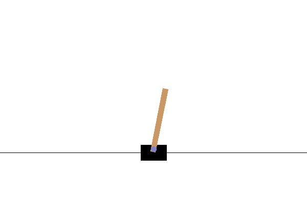
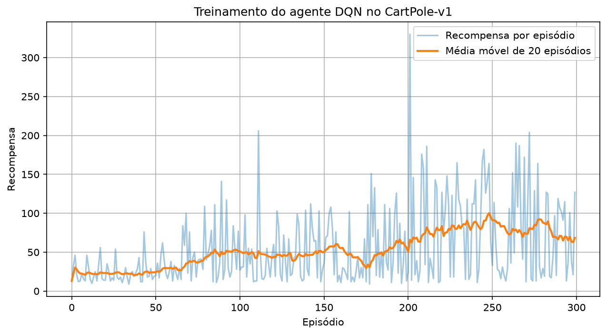
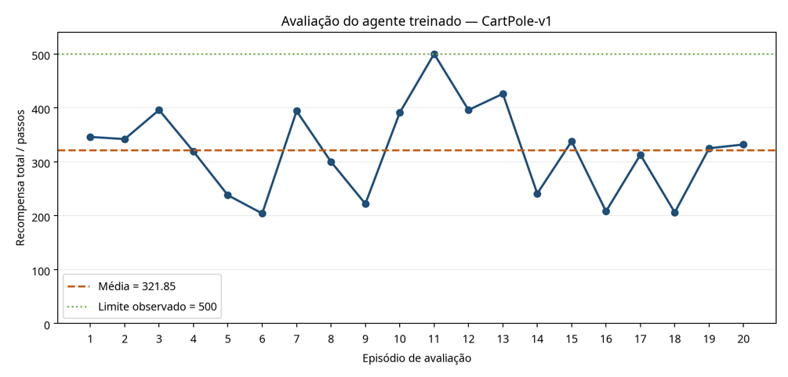

# RELATÓRIO FINAL: DESENVOLVIMENTO DE UM AGENTE DE APRENDIZAGEM POR REFORÇO COM DEEP Q-NETWORK NO AMBIENTE CARTPOLE-V1

## 1. INTRODUÇÃO

A aprendizagem por reforço é uma abordagem de Inteligência Artificial na qual um agente aprende a tomar decisões por meio da interação com um ambiente. Em cada interação, o agente observa o estado atual, escolhe uma ação e recebe uma recompensa associada ao resultado da ação. O objetivo é aprender uma política que maximize a recompensa acumulada ao longo dos episódios.

Nessa atividade, o problema foi concretizado por meio do ambiente CartPole-v1. O agente deve controlar um carrinho horizontal para manter uma haste equilibrada durante o maior número possível de passos. A solução utiliza a rede neural para aproximar os valores Q das ações, isto é, uma estimativa da qualidade da casa ação em determinado estado.

## 2. DOMÍNIO TRATADO

O domínio tratado é o controle autônomo de um sistema dinâmico simples, apresentado sob a forma de um jogo/simulação. O agente não recebe instruções explicitas sobre qual ação executar em cada estado. Em vez disso, ele aprende a partir das recompensas obtidas: cada execução começa com uma configuração inicial do carrinho e termina quando a haste cai, o carrinho sai dos limites ou o limite temporal do ambiente é alcançado.

## 3. OBJETIVOS GERAL E ESPECÍFICOS

O objetivo geral é desenvolver um agente baseado em deep learning capaz de jogar autonomamente o ambiente CartPole-v1, aprendendo uma estratégia de controle que maximize o tempo de equilíbrio da haste.

Quanto aos objetivos específicos, pode-se citar:

- configurar e testar o ambiente Gymnasium CartPole-v1, cuja documentação está disponível em: https://gymnasium.farama.org/environments/classic_control/cart_pole/. Acessado em 08 nov. 2026;
- Modelar o problema como aprendizagem por reforço com ações discretas;
- Implementar um Deep Q-Network (DQN) em TensorFlow;
- Construir dinamicamente o dataset a partir das interações do agente com o ambiente;
- Treinar o agente com replay buffer e rede-alvo;
- Avaliar o agente em episódios independentes, com exploração desligada; e
- Analisar criticamente os resultados e propor melhorias.

## 4. PROPOSTA DE SOLUÇÃO

A solução proposta segue o ciclo agente–ambiente: o agente observa o estado, seleciona uma ação, recebe a recompensa e observa o próximo estado. As experiências são armazenadas numa memória de replay. Após acumular um número mínimo de experiências, são amostrados lotes aleatórios para atualizar a rede principal. Periodicamente, os pesos da rede principal são copiados para a rede-alvo, contribuindo para maior estabilidade no cálculo dos alvos de aprendizagem.

## 5. SOBRE O AMBIENTE JOGÁVEL

O CartPole-v1 foi escolhido por ser um ambiente clássico, simples de configurar e suficientemente representativo dos desafios de aprendizagem por reforço. A escolha também facilita a reprodução do experimento em computadores pessoais, a inspeção dos estados e a interpretação das recompensas.

As características do ambiente podem ser descritas a seguir:

| Elemento | Descrição |
|---|---|
| Estado/observação | Vetor com 4 valores: posição do carrinho, velocidade do carrinho, ângulo da haste e velocidade angular da haste. |
| Ações | Espaço discreto com 2 ações: mover o carrinho para a esquerda ou para a direita. |
| Recompensa | 1,0 a cada passo em que a tarefa permanece válida. |
| Terminação | Queda da haste, saída do carrinho dos limites ou alcance do limite temporal. |
| Objetivo operacional | Maximizar o número de passos e, consequentemente, a recompensa acumulada. |
| Limite de avaliação | O ambiente permite atingir até 500 passos/recompensa em um episódio bem-sucedido. |

## 6. VERIFICAÇÃO INICIAL

Antes do treinamento, foi executado um programa de teste que criou o ambiente, reiniciou o episódio, imprimiu o estado inicial, verificou o espaço de observações e o espaço de ações e executou dez passos com ações aleatórias. Essa etapa confirmou a comunicação correta entre o programa e o ambiente, além de validar que o estado possuía dimensão 4 e que as ações eram discretas.

## 7. MODELO DE DEEP LEARNING DESENVOLVIDO

Foi implementada uma Deep Q-Network (DQN). A rede recebe o vetor de estado como entrada e produz dois valores Q, um para cada ação possível. O agente escolhe a ação com maior valor Q durante a avaliação. Durante o treinamento, a estratégia epsilon-greedy permite alternar entre exploração de ações aleatórias e aproveitamento da política aprendida.

Sobre a sua arquitetura, pode-se observar o seguinte:

| Camada | Configuração | Função |
|---|---|---|
| Entrada | 4 valores | Representa o estado observado no CartPole. |
| Oculta 1 | 128 neurônios, ReLU | Aprende combinações não lineares das variáveis do estado. |
| Oculta 2 | 128 neurônios, ReLU | Refina a representação utilizada para estimar as ações. |
| Saída | 2 neurônios, linear | Produz os valores Q para esquerda e direita. |

Quanto aos componentes do algoritmo, tem-se:

- **Replay buffer:** memória limitada que armazena experiências e permite amostragem aleatória de lotes.
- **Epsilon-greedy:** começa com exploração elevada e reduz gradualmente epsilon até um mínimo de 0,01.
- **Rede principal:** é treinada para aproximar os valores Q-alvo.
- **Rede-alvo:** fornece estimativas mais estáveis dos valores Q dos próximos estados e é atualizada periodicamente.
- **Equação de Bellman:** o alvo é calculado como recompensa mais o fator de desconto multiplicado pelo melhor valor Q do próximo estado, exceto quando o episódio termina.

O ajuste inicial foi realizado sobre os principais hiperparâmetros do algoritmo. A configuração usada no experimento principal é apresentada abaixo. O tuning foi concebido como uma etapa incremental: primeiro foi garantida a execução do protótipo, em seguida, foram definidos valores estáveis para o tamanho da rede, a taxa de aprendizagem, o fator de desconto, a memória e a redução da exploração.

| Parâmetro | Valor utilizado | Justificativa/efeito |
|---|---:|---|
| Episódios de treino | 300 | Permite observar a evolução inicial sem tornar a execução excessivamente longa. |
| Tamanho do lote | 64 | Equilíbrio entre estabilidade estatística e custo computacional. |
| Capacidade da memória | 50.000 experiências | Mantém um histórico diversificado de interações. |
| Taxa de aprendizagem | 0,001 | Controla o tamanho das atualizações dos pesos. |
| Fator de desconto (gamma) | 0,99 | Valoriza recompensas futuras, apropriado para manter a haste equilibrada. |
| Epsilon inicial | 1,00 | Prioriza exploração no início do treino. |
| Epsilon mínimo | 0,01 | Mantém pequena exploração residual. |
| Decaimento de epsilon | 0,995 | Reduz gradualmente a aleatoriedade. |
| Atualização da rede-alvo | A cada 10 episódios | Diminui oscilações nos alvos de treinamento. |

## 8. DATASET E PROCESOS DE TREINO

Não foi utilizado um dataset externo pronto. Em aprendizagem por reforço, os dados são gerados pelo próprio agente ao interagir com o ambiente. Cada registro armazenado no replay buffer tem a forma: (estado atual, ação, recompensa, próximo estado, finalizado). Assim, o dataset é um conjunto de transições produzidas durante os episódios de treinamento.

| Campo | Descrição |
|---|---|
| Estado | Vetor numérico com as quatro variáveis observadas. |
| Ação | Inteiro 0 ou 1, correspondente a esquerda ou direita. |
| Recompensa | Valor recebido após a ação, normalmente 1,0 enquanto a tarefa continua. |
| Próximo estado | Novo vetor observado após a ação. |
| Finalizado | Indica se o episódio terminou por terminação ou truncamento. |

No processo de treinamento:

1. O ambiente é reiniciado e o estado inicial é obtido.
2. O agente escolhe uma ação segundo a estratégia epsilon-greedy.
3. A ação é executada e o ambiente devolve próximo estado, recompensa e indicação de término.
4. A transição é armazenada no replay buffer.
5. Quando existem pelo menos 64 experiências, um lote aleatório é utilizado para treinar a rede principal.
6. O epsilon é reduzido gradualmente, diminuindo a exploração ao longo dos episódios.
7. A rede-alvo recebe os pesos da rede principal a cada 10 episódios.
8. Ao final, o modelo é salvo em formato Keras e as recompensas e perdas são exportadas para arquivos CSV.

Os artefatos produzidos foram:

- `agente_cartpole.keras`: modelo treinado.
- `recompensas_cartpole.csv`: recompensas por episódio de treino.
- `perdas_cartpole.csv`: valores de perda registrados durante o treino.
- `grafico_treinamento_cartpole.png`: visualização da recompensa e da média móvel.
- `teste_ambiente.py`, `treino_dqn.py` e `testar_agente.py`: scripts de reprodução.

## 9. AVALIAÇÃO E RESULTADOS

Após o treinamento, o modelo salvo foi carregado e testado sem nova atualização dos pesos. Durante a avaliação, a exploração aleatória foi desligada: em cada estado, o agente escolheu a ação com maior valor Q previsto. Como a recompensa do CartPole é 1,0 por passo, a recompensa total coincide com o número de passos sobrevividos no episódio.

Quanto ao teste com 5 episódios:

| Episódio | Passos | Recompensa total |
|---:|---:|---:|
| 1 | 232 | 232 |
| 2 | 347 | 347 |
| 3 | 316 | 316 |
| 4 | 201 | 201 |
| 5 | 214 | 214 |

| Métrica | Valor |
|---|---:|
| Recompensa média | 262,00 |
| Melhor recompensa | 347,00 |
| Pior recompensa | 201,00 |

Quanto ao teste com 20 episódios:

| Episódio | Passos | Recompensa total |
|---:|---:|---:|
| 1 | 346 | 346 |
| 2 | 342 | 342 |
| 3 | 396 | 396 |
| 4 | 319 | 319 |
| 5 | 238 | 238 |
| 6 | 204 | 204 |
| 7 | 394 | 394 |
| 8 | 300 | 300 |
| 9 | 222 | 222 |
| 10 | 391 | 391 |
| 11 | 500 | 500 |
| 12 | 396 | 396 |
| 13 | 426 | 426 |
| 14 | 241 | 241 |
| 15 | 338 | 338 |
| 16 | 208 | 208 |
| 17 | 313 | 313 |
| 18 | 206 | 206 |
| 19 | 325 | 325 |
| 20 | 332 | 332 |

| Métrica | Valor |
|---|---:|
| Recompensa média | 321,85 |
| Melhor recompensa | 500,00 |
| Pior recompensa | 204,00 |
| Desvio padrão | 80,41 |

## 10. ANÁLISE CRÍTICA

Os resultados mostram que em vinte episódios, a recompensa média foi 321,85, o que significa que, em média, a haste permaneceu equilibrada por mais de trezentos passos. O episódio 11 atingiu o limite de 500, indicando que o agente foi capaz de resolver completamente a tarefa em pelo menos uma execução.

Porém, a comparação entre os testes deve ser interpretada com cautela. A média de cinco episódios foi 262,00, enquanto a média de vinte episódios foi 321,85. A diferença não deve ser atribuída automaticamente a uma melhoria do modelo, pois os testes podem ter utilizado sequências de estados iniciais diferentes. O teste com vinte episódios oferece uma estimativa mais informativa do desempenho médio.

A diferença entre o melhor resultado, 500, e o pior resultado, 204, evidencia que o agente ainda não é totalmente consistente. O desvio padrão de 80,41 confirma dispersão considerável entre as execuções. Uma possível causa é a sensibilidade do CartPole a pequenas diferenças no estado inicial e a limitações do treinamento DQN com uma única configuração de hiperparâmetros.

Além disso, é importante distinguir recompensa de qualidade geral. Neste ambiente, como cada passo válido gera uma recompensa constante de 1, a recompensa é uma medida direta do tempo de equilíbrio. Em ambientes mais complexos, seria necessário analisar recompensas positivas e negativas, custos de ações, taxas de sucesso e outras métricas.

Quanto aos pontos fortes, o trabalho apresenta um protótipo totalmente reproduzível, desenvolvido em um ambiente padronizado que assegura a confiabilidade dos experimentos. A arquitetura da rede neural é simples e adequada à dimensão do espaço de estados do CartPole, permitindo um processamento eficiente. Destaca-se também a incorporação de componentes fundamentais para a estabilização do algoritmo Deep Q-Network (DQN), como o replay buffer e a rede-alvo (target network). Além disso, a metodologia de validação foi abrangente, incluindo uma avaliação consistente em 20 episódios além do teste inicial de 5 episódios, acompanhada do devido registro do modelo treinado, das recompensas obtidas e do histórico de perdas.

Entre as limitações do experimento, destaca-se o fato de ter sido utilizada apenas uma configuração principal de hiperparâmetros. Embora os valores escolhidos tenham permitido o desenvolvimento de um agente funcional, não foi realizada uma comparação sistemática com diferentes taxas de aprendizagem, tamanhos de lote, fatores de desconto, capacidades do replay buffer ou frequências de atualização da rede-alvo. Dessa forma, não é possível afirmar que a configuração utilizada representa a melhor combinação possível para o ambiente CartPole-v1. A ausência de uma busca mais ampla limita a avaliação sobre a influência de cada parâmetro no desempenho final do agente.

Outra limitação está relacionada à quantidade de experiências utilizadas para avaliar o modelo. Apesar de terem sido realizados testes com 5 e 20 episódios, esses valores ainda são relativamente reduzidos para caracterizar completamente o comportamento de uma política de aprendizagem por reforço. Os resultados podem variar de acordo com o estado inicial do ambiente e com as sementes aleatórias utilizadas. Portanto, uma avaliação baseada em um número maior de episódios poderia fornecer uma estimativa mais confiável da recompensa média, da taxa de sucesso e da estabilidade do agente.

Não foram utilizados múltiplos treinamentos com diferentes sementes aleatórias. Tanto a inicialização da rede neural quanto a geração dos estados iniciais, a seleção de ações exploratórias e a amostragem do replay buffer podem influenciar o resultado. Como consequência, um único treinamento não permite determinar se o desempenho obtido é consistente ou se dependeu de uma sequência específica de eventos aleatórios. Para reduzir esse problema, seria recomendável executar o treinamento várias vezes, utilizando diferentes sementes, e apresentar a média e o desvio padrão dos resultados entre as execuções.

O tamanho e a complexidade do ambiente também constituem uma limitação. O CartPole-v1 possui apenas quatro variáveis de estado e duas ações discretas, sendo considerado um problema relativamente simples. Assim, o bom desempenho obtido nesse ambiente não garante que o mesmo modelo funcionaria adequadamente em tarefas mais complexas, como LunarLander, BipedalWalker ou ambientes Atari. Esses ambientes apresentam espaços de estados maiores, ações mais variadas e recompensas potencialmente mais complexas, exigindo técnicas de pré-processamento, arquiteturas mais robustas e maior quantidade de dados.

Como sugestões de melhorias, pode-se citar: executar pelo menos três treinos com sementes diferentes e reportar média e desvio padrão entre execuções; testar 500 ou mais episódios de treino para verificar se a consistência melhora; testar diferentes tamanhos de lote e frequências de atualização da rede-alvo; e avaliar o modelo em diferentes sementes do ambiente.

## 11. CONSIDERAÇÕES FINAIS

O trabalho demonstrou a construção de um agente de aprendizagem por reforço baseado em deep learning para o CartPole-v1. A solução integrou Gymnasium, TensorFlow, uma rede neural DQN, replay buffer, estratégia epsilon-greedy e rede-alvo. O dataset foi produzido automaticamente durante as interações do agente, sem necessidade de rotulagem manual.

Os resultados de avaliação indicam que o agente aprendeu a controlar o carrinho de forma significativa: obteve média de 262,00 em cinco episódios e 321,85 em vinte episódios, com um episódio atingindo 500 pontos. Apesar do desempenho satisfatório, a variabilidade entre episódios mostra que o modelo ainda pode ser aprimorado. A execução de múltiplas experiências, o ajuste sistemático de hiperparâmetros e a adoção de variantes mais robustas de DQN são os próximos passos recomendados.

## 12. LINK DO GITHUB

https://github.com/brmoitinho/agente-dqn-cartpole
